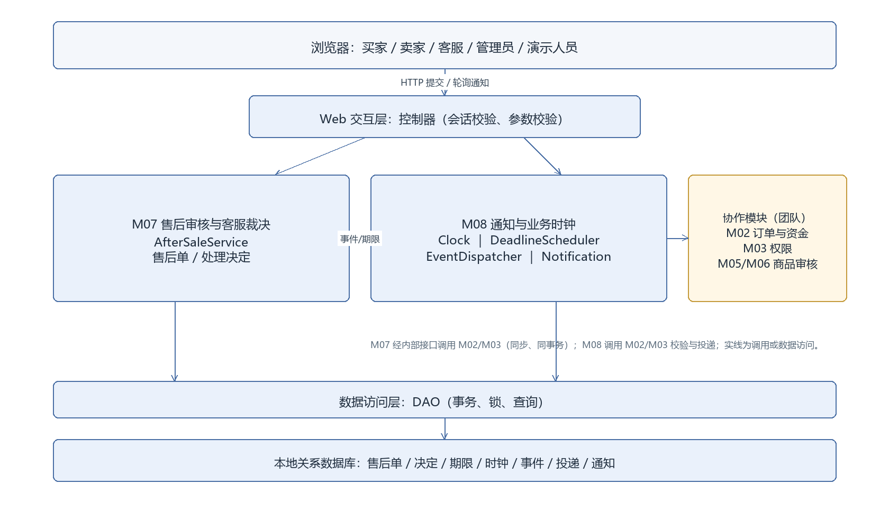
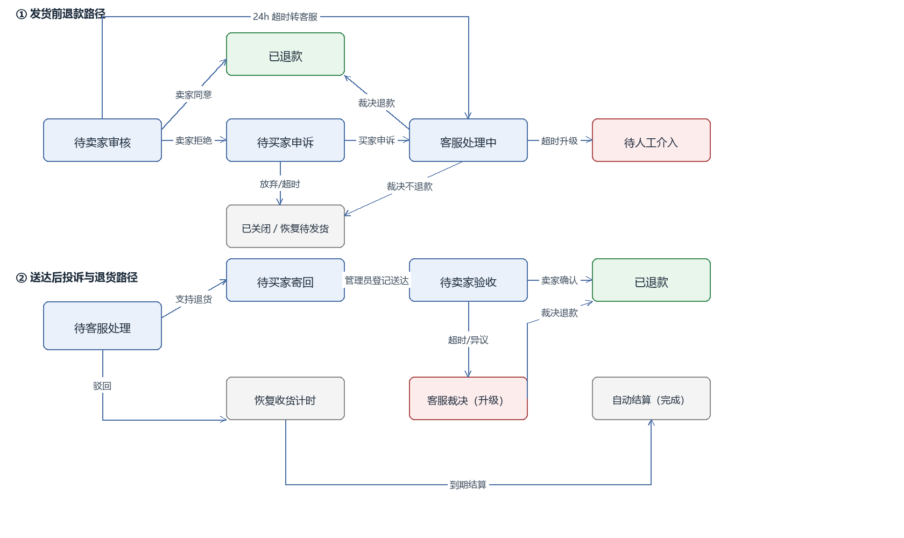

> 阅读版：由同名 docx 转换，版本号见标题。

# 阶段3 模块结构与关键设计（V1.4）

**文档修订记录**

| 版本 | 日期 | 修订内容 |
| --- | --- | --- |
| V1.0 | 11-05 | 阶段1 上下文：模块范围、需求清单、开发约束、关键易变点 |
| V1.1 | 11-06 | 阶段2 评审：方案A/B 草案、4 条分歧、合并折中裁决 |
| V1.2 | 11-06 | 阶段3 结构与关键设计：架构图、状态机、接口、数据表、决策汇总 |
| V1.3 | 11-06 | 补充接口字段级定义与易变点隔离映射 |
| V1.4 | 11-10 | 新增 S19 售后留言：组件、内部接口与字段定义；CR-02 审核期 48 小时 |

本阶段依据阶段2 的裁决（以方案 B 分层单体为基底，借用方案 A 的局部事件与时钟接口），完成 M07、M08 模块结构、数据、接口与关键处理规则的精化，并明确在团队方案基础上自主新增的关键细节。

## 3.1 最终架构与本地部署

最终形态为浏览器/服务器（B/S）的分层单体：浏览器通过 HTTP 提交操作并轮询通知；后端按 Web 交互层、业务层、数据访问层划分；M07 与 M08 位于业务层，共享同一个本地关系数据库。售后决定与 M02 的资金修改在同一事务中提交；通知事件随业务事务写入，提交后由 M08 的分发器生成站内通知，失败重试不回滚业务。

部署上，浏览器、一个后端应用、本地数据库与图片目录运行在同一台电脑，演示时不依赖外网；业务时间由 M08 的统一 Clock 提供，授权演示人员可推进模拟时间。

**图3-1 系统分层与 M07/M08 的调用关系**

## 3.2 模块职责与关键依赖

**表3-1 模块与组件职责**

| 组件 | 职责 | 关键依赖/通信方式 | 对应需求 |
| --- | --- | --- | --- |
| AfterSaleService | 售后单状态机、决定记录、期限校验与升级判定 | 同库事务；经内部接口调 M02 资金与订单；调用 M08 记录期限 | S01～S09、S13～S14 |
| CaseMessageService | 售后留言读写与三方权限校验；写入后调用 M08 发通知 | 同库事务；留言表只追加，不改售后状态 | S19 |
| DeadlineScheduler | 扫描到期任务，按类型调用售后或订单业务方法 | 读取期限表；调用 AfterSaleService；任务代次校验 | S07～S09、S13～S14 |
| ClockService | 提供统一业务时间，支持演示快进 | 单例服务；推进操作写审计记录 | S13 |
| EventDispatcher / Notification | 读取已提交事件，生成站内通知与未读数 | 轮询事件表；按权限发送；失败重试 | S15～S16 |
| FundAdapter | 封装 M02 的退款、暂停、恢复、关闭订单接口 | 同步调用，事务内生效 | S01～S09 |

## 3.3 售后单状态机

售后单分为发货前退款与送达后投诉两条路径，状态与转换如下。所有转换在事务内完成，先锁订单、再锁售后单，转换前重新校验当前状态与期限。

**图3-2 售后单状态机**

**表3-2 主要状态转换**

| 当前状态 | 事件 | 下一状态 | 触发者 | 规则 |
| --- | --- | --- | --- | --- |
| 待卖家审核 | 卖家同意 | 已退款 | 卖家 | 调 M02 退款并关闭订单 |
| 待卖家审核 | 卖家拒绝 | 待买家申诉 | 卖家 | 保存拒绝理由；开启 24 小时申诉期 |
| 待卖家审核 | 24 小时超时 | 客服处理中 | M08 调度器 | 仅转客服，不判定卖家责任 |
| 待买家申诉 | 买家申诉 | 客服处理中 | 买家 | 订单保持冻结 |
| 待买家申诉 | 放弃或超时 | 恢复待发货 | 买家/系统 | 恢复订单为待发货 |
| 客服处理中 | 裁决退款 | 已退款 | 客服 | 指示 M02 执行；记录理由 |
| 客服处理中 | 裁决不退款 | 恢复待发货 | 客服 | 恢复订单；平台继续暂管 |
| 客服处理中 | 超时未处理 | 待人工介入 | M08 调度器 | 管理员改派、延期一次或标记异常 |
| 待客服处理 | 驳回投诉 | 恢复收货计时 | 客服 | 按剩余时长恢复，重复驳回不延长 |
| 待客服处理 | 支持退货 | 待买家寄回 | 客服 | 通知买家寄回并上传凭证 |
| 待买家寄回 | 管理员登记送达 | 待卖家验收 | 管理员 | M08 起算 24 小时验收期限 |
| 待卖家验收 | 卖家确认收回 | 已退款 | 卖家 | 调 M02 退回暂管货款 |
| 待卖家验收 | 超时或异议 | 客服裁决（升级） | M08/卖家 | 平台继续暂管，不自动退款 |
| 恢复收货计时 | 收货期限到期 | 自动结算（完成） | M08 调度器 | 将暂管货款结算给卖家 |

## 3.4 内部接口

接口均为后端内部接口，调用者从登录会话取得操作者身份；修改类接口额外携带请求标识，用于识别重复提交。

**表3-3 内部接口与失败原因**

| 接口 | 输入 → 输出 | 主要校验与失败原因 |
| --- | --- | --- |
| AfterSale.requestRefund | 订单号、理由、请求标识 → 售后单号 | 订单已付款且未发货；无进行中售后；否则返回状态不符 |
| AfterSale.appeal | 售后单号、理由、请求标识 → 售后状态 | 卖家已拒绝且在申诉期内；否则返回期限已过 |
| AfterSale.complain | 订单号、理由、凭证 → 售后单号 | 已送达、未结算、无重复投诉；否则拒绝 |
| AfterSale.decide | 售后单号、决定、理由、请求标识 → 处理结果 | 角色为卖家或客服；状态允许裁决；否则返回无权或状态不符 |
| AfterSale.acceptReturn | 退货记录号、请求标识 → 处理结果 | 卖家身份；退货状态允许；否则拒绝 |
| AfterSale.dispute | 售后单号、异议理由、请求标识 → 处理结果 | 仅卖家在验收期内可提出 |
| AfterSale.postMessage | 售后单号、留言内容 → 留言记录 | 买家、卖家或客服；长度 1～500 字 |
| AfterSale.getMessages | 售后单号 → 留言列表 | 同上；按时间升序返回 |
| Clock.now / advance | 无参数／授权会话、快进时长 → 业务时间 | 快进需演示人员权限，记录审计 |
| Deadline.schedule/pause/resume | 对象、类型、截止或剩余时长 → 任务代次 | 由业务模块调用；恢复时生成新代次 |
| Notification.list/read | 会话、未读筛选／通知号 → 通知列表 | 仅返回当前用户有权查看的通知 |

## 3.5 在团队方案基础上新增的关键细节

按任务书要求，在阶段2 裁决与团队总稿的基础上，本人在负责模块内新增并细化以下设计，均已在阶段2 的裁决表中登记。

**表3-4 新增关键细节及理由**

| 编号 | 新增或细化的内容 | 理由 | 标记 |
| --- | --- | --- | --- |
| AD-S06 | 期限任务代次：每次更新期限生成新代次，旧代次任务执行前发现失效即结束 | 防止暂停恢复后旧任务覆盖新期限或重复结算 | 【Revised】 |
| AD-S07 | 通知去重键：以“事件号＋收件人”唯一约束站内通知，以“事件号＋处理器”唯一约束投递记录 | 重复投递不重复生成通知，便于失败重试 | 【Revised】 |
| AD-S08 | 请求标识幂等：同一用户相同请求标识与参数重复提交时返回原结果，参数不同则拒绝 | 防止重复退款与重复登记送达 | 【Revised】 |
| AD-S09 | 客服超时升级管理员：管理员仅可改派、延期一次或标记异常，仍不自动退款 | 权限边界闭合，避免管理员绕过裁决直接动钱 | 【AI-Adopted】方案A/B合并后补充 |

## 3.6 裁决认定汇总

**表3-5 阶段2 与阶段3 的架构决策汇总**

| 编号 | 决策内容 | 标记与来源 |
| --- | --- | --- |
| AD-S01 | 分层单体 + 同步业务事务 + 单后端部署 | 【AI-Adopted】方案B |
| AD-S02 | Outbox 事件表 + 分发器，仅用于通知 | 【Revised】合并 A 的事件机制与 B 的事务模型 |
| AD-S03 | 统一 Clock 与 Deadline 接口 | 【AI-Adopted】方案A |
| AD-S04 | 业务模块之间全部事件化 | 【Rejected】方案A，契约与调试成本高 |
| AD-S05 | 通知逻辑直接写在业务服务中 | 【Rejected】方案B，污染业务代码 |
| AD-S06～AD-S08 | 任务代次、通知去重键、请求标识幂等 | 【Revised】阶段3 自主细化 |
| AD-S09 | 客服超时升级与管理员权限边界 | 【AI-Adopted】阶段2 裁决后补充 |

## 3.7 接口字段级定义

在 3.4 的接口职责基础上，补充各接口的请求字段、响应字段与主要错误码，供前后端联调直接使用。

**表3-6 接口字段与错误码**

| 接口 | 请求字段 | 响应字段 | 主要错误码 |
| --- | --- | --- | --- |
| requestRefund | orderId, reason, requestId | afterSaleId, status | ORDER_STATUS_INVALID, DUPLICATE_REQUEST |
| appeal | afterSaleId, reason, requestId | status | NOT_IN_APPEAL_WINDOW |
| complain | orderId, reason, evidence, requestId | afterSaleId, status | NOT_DELIVERED, ALREADY_SETTLED |
| decide | afterSaleId, decision, reason, requestId | status, decisionId | FORBIDDEN, STATUS_INVALID |
| acceptReturn | afterSaleId, requestId | status, flowId | NOT_SELLER, STATUS_INVALID |
| dispute | afterSaleId, reason, requestId | status | NOT_IN_CHECK_WINDOW |
| postMessage | afterSaleId, content | messageId, role, createdAt | FORBIDDEN, INVALID_MESSAGE |
| getMessages | afterSaleId | items | FORBIDDEN, NOT_FOUND |
| clockAdvance | seconds | businessTime | FORBIDDEN |
| notificationList | unreadOnly | items, unreadCount | UNAUTHORIZED |

## 3.8 易变点与隔离措施映射

将阶段1 识别的易变点与最终设计中的隔离措施逐条对应，说明架构对变化的支撑方式。

**表3-7 易变点与隔离措施**

| 易变点 | 可能变化 | 隔离措施 | 涉及组件 |
| --- | --- | --- | --- |
| V-S1 资金接口 | 暂停/恢复/退款/关闭接口参数或条件调整 | FundAdapter 封装，业务只依赖接口约定；事务上下文由业务层控制 | AfterSaleService、FundAdapter |
| V-S2 期限规则 | 审核、申诉、验收期限时长与起算点变化 | 期限类型与时长集中配置，任务按类型调用业务方法 | DeadlineScheduler |
| V-S3 通知渠道 | SSE 改轮询或收件人规则调整 | 事件与处理器分离，分发器集中收件人规则 | EventDispatcher、Notification |
| V-S4 演示时间 | 快进粒度变化或可回拨 | Clock 接口隔离，推进操作写审计 | ClockService |

## 附件2 数据设计与核心过程设计

本附件给出 M07、M08 的数据设计与核心过程设计结果；高层架构图已在 3.1 呈现，此处不重复。

### A2.1 数据设计

**表A2-1 主要数据表**

| 表名 | 关键字段 | 约束与用途 |
| --- | --- | --- |
| after_sale | 售后单号、订单号、类型、状态、理由、凭证、买家/卖家、创建时间 | 售后流程主表；状态与类型受状态机约束 |
| after_sale_decision | 决定号、售后单号、操作者、角色、决定、理由、时间 | 每次裁决一条，用于审计与追溯 |
| deadline | 对象类型、对象号、期限类型、截止时刻、剩余时长、暂停标志、代次 | 到期任务依据；恢复时写新代次 |
| clock_state | 基准时间、模式（正常/演示）、更新时间 | 统一业务时间基准 |
| outbox_event | 事件号、类型、业务对象、载荷、创建时间、提交标志 | 随业务事务写入，供分发器读取 |
| event_delivery | 事件号、处理器、状态、尝试次数、下次执行时间、失败原因 | 分发重试与去重；事件号+处理器唯一 |
| notification | 通知号、事件号、收件人、内容引用、已读时间 | 站内通知；事件号+收件人唯一 |

### A2.2 核心过程设计

过程一：驳回送达后投诉（结算限制恢复）。

1. 核验客服权限，开启事务，检查请求标识是否已完成；

2. 先锁订单、再锁售后单，确认投诉仍待处理且平台未结算；

3. 读取保存的剩余收货时长，新截止时刻 = Clock.now() + 剩余时长；

4. 保存驳回决定，调用 M02 解除结算限制；

5. 调用 M08 恢复期限并生成新任务代次，使旧代次失效；

6. 保存审计、请求结果与通知事件后提交；任一环节失败则回滚，通知在提交后由分发器处理。

过程二：卖家确认退货并退款。

1. 核验卖家身份与退货状态，开启事务并检查请求标识；

2. 锁定订单、售后单与暂管记录，确认平台仍在暂管该笔货款；

3. 调用 M02 将暂管货款退回买家账户（不含退货运费）；

4. 保存唯一退款流水、订单关闭状态、审计与通知事件后提交；

5. 通知事件由分发器生成站内通知，失败按上限重试，不撤销已提交的业务结果。

### A2.3 验证场景

**表A2-2 设计验证场景**

| 编号 | 场景 | 预期结果 |
| --- | --- | --- |
| T-S01 | 快进时间跨过卖家 24 小时审核期 | 售后单转客服，不自动退款，货款继续暂管 |
| T-S02 | 暂停 28 小时后驳回投诉 | 恢复后剩余 28 小时，重复驳回不再延长 |
| T-S03 | 重复提交同一退款请求（相同请求标识） | 返回原结果，只产生一条流水与一条通知 |
| T-S04 | 重复投递同一通知事件 | 同一收件人只生成一条通知，不触发资金操作 |
| T-S05 | 服务重启后继续执行未完成期限任务 | 任务按持久化状态继续，旧代次任务失效 |
| T-S06 | 客服 48 小时未处理售后单 | 升级管理员，管理员仅能改派/延期/标记，仍不自动退款 |
| T-S07 | 客服越权调用退款接口 | 请求被拒绝并记录审计 |
