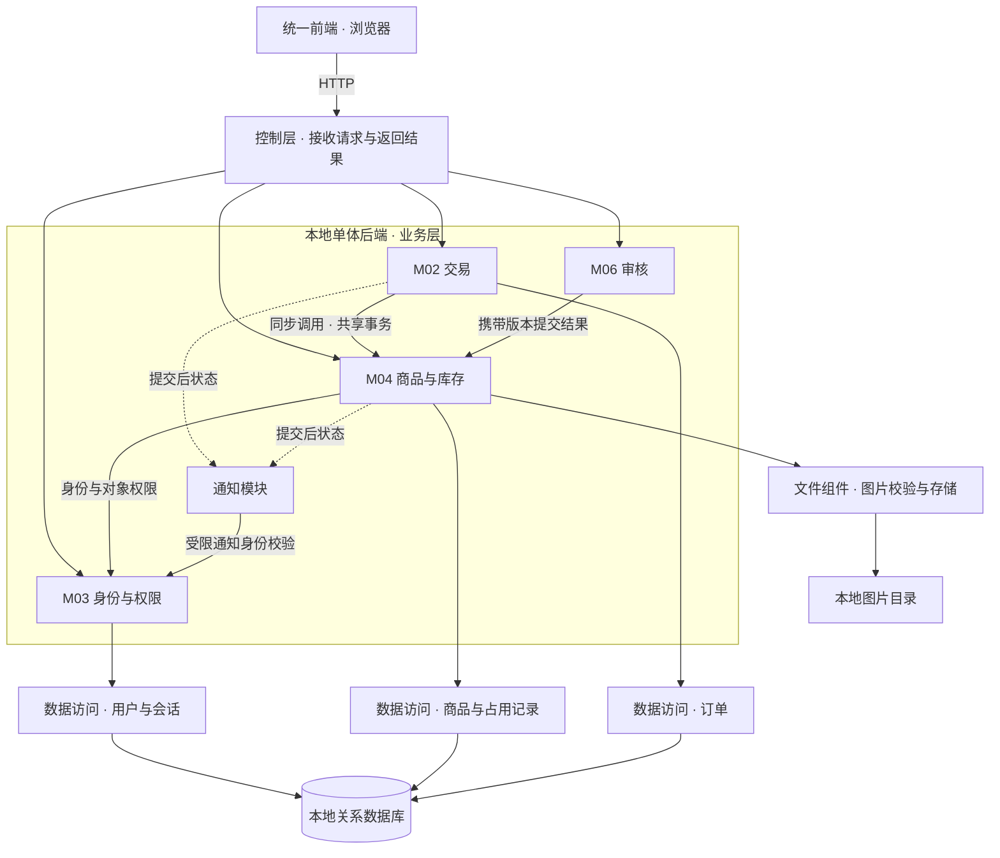

# 架构设计阶段3架构决策与精化

负责人：鲁瑞祺  
项目：校园二手商品交易系统  
日期：2026年11月7日  
文档版本：V2.0  
范围：M03 用户身份与权限、M04 商品发布与维护  
状态：个人架构方案已裁决，跨模块接口需与团队核对

## 一 设计依据与阶段2裁决

采用以方案B的MVC分层单体为基础、借用方案A商品模块封装的折中方案。统一前端通过HTTP调用后端。后端按控制层、业务层和数据访问层组织，交易和审核通过M04业务接口提交商品操作，由M04负责商品主数据和库存占用记录的写入。商品规则变化时，改动主要集中在M04。

本方案依据需求规格说明书V2.0。M03负责注册、登录、退出、本人资料与权限。M04支持多件商品库存、改价重审、版本检查、下架，以及卖家接受购买申请时的库存处理。项目由四人协作并在本地运行，采用团队统一的技术栈和关系数据库，支付、资金和物流使用模拟数据。跨模块依赖集中在交易、审核、通知和统一前端。

- [阶段2方案评审与裁决](https://github.com/Helloworld-chen/Engineering/blob/鲁瑞祺/docs/个人专项作业/鲁瑞祺/架构设计/鲁瑞祺架构设计阶段2_方案评审与裁决_提交版.md)
- [需求规格说明书V2.0](https://github.com/Helloworld-chen/Engineering/blob/鲁瑞祺/docs/个人专项作业/鲁瑞祺/需求分析/鲁瑞祺需求分析阶段3.0需求规格说明书2.0版.md)

## 二 阶段3新增设计

### 2.1 决定与理由

我选择在M04内增加按订单商品项保存的库存占用记录。每项记录保存订单商品项标识、商品编号、占用数量和处理状态。重复请求到达时，可以根据已保存的记录判断库存是否已经处理，防止重复扣减或释放。出现数量不一致时，也可以按订单定位对应记录，便于排查。

这项精化把阶段2的“交易调用M04、共享事务”细化为具体的数据和状态设计。每个订单商品项多保存一条记录，换取占用可追查和重复操作可识别。商品模块把状态转换规则留在内部，交易模块提供合法的订单动作和稳定的业务标识。

上段是根据实际取舍整理的裁决说明。阶段3对话中，AI提出了库存占用记录的设计，学生回复“选择，可以放置重复减扣和方便排查吧”。

### 2.2 记录与状态

| 字段 | 用途 |
| --- | --- |
| 订单商品项标识 | 由交易模块在占用前提供，作为库存占用记录的唯一业务键。重试沿用同一标识 |
| 商品编号 | 关联被占用的商品 |
| 占用数量 | 记录该项订单确认占用的数量，用于释放或转为已售 |
| 处理状态 | 占用中、已释放、已售出 |
| 创建及更新时间 | 辅助核对处理顺序和排查问题 |

同一业务键只对应一条记录，释放和售出后保留该记录。商品维护总量、有效占用数量和已售数量，可购买数量由“总量－有效占用数量－已售数量”得出。记录状态与商品数量应同步提交。

| 动作 | 前置条件与状态转换 | 对数量的影响 |
| --- | --- | --- |
| 接受并占用 | 卖家接受合法申请，商品审核通过、未下架、数量充足。创建「占用中」记录 | 有效占用增加，可购买数量相应减少 |
| 合法取消或失效 | 交易模块确认动作合法，记录从「占用中」变为「已释放」 | 有效占用减少，可购买数量相应增加 |
| 完成出售 | 交易模块确认完成，记录从「占用中」变为「已售出」 | 有效占用减少，已售增加同等数量，可购买数量不变 |
| 重复或冲突请求 | 相同动作已处理时保持已保存结果。相同键的商品或数量不一致，或对终态发起冲突动作时，返回冲突 | 保持数量与状态 |

例如，教材总量为3本，某订单占用2本后剩1本可购买。合法取消使占用记录变为「已释放」，可购买数量恢复到3本。再次收到同一取消请求时，根据该记录识别已经处理，仍为3本。

### 2.3 事务与并发约定

1. **交易层负责发起事务。**M02核对订单动作，通过同一次数据库事务同步调用M04。M02维护订单，M04维护商品数量和占用记录，最后由外层统一提交或回滚。
2. **占用时原子检查并更新库存。**M04按商品编号和当前条件更新有效占用数量，写入前要求审核通过、未下架、可购买数量不少于本次申请量。数据库的条件更新负责并发检查，库存不足时返回整份失败。占用记录的唯一业务键限制重复占用。记录、商品数量或订单写入任一步失败，事务整体回滚。
3. **释放和售出以当前记录状态为条件。**只有成功将「占用中」转为相应终态的操作才能变更数量。两个并发请求争抢同一笔占用时，只允许一次状态转换。遇到唯一键冲突时，先回滚该次写入，再核对已提交的占用记录，区分重试与参数冲突。
4. **维护及审核使用版本条件。**卖家修改时检查商品归属、当前版本和允许维护的库存状态。审核结果携带审核所针对的版本，旧结果不能覆盖新内容。合法内容修改和改价触发重审及隐藏。已有订单保存其成交信息。

唯一业务键、条件更新和事务传播是落实本次精化的设计细节。数据库选型、事务实现及错误码由团队在接口联调前统一。退款、退货与合法取消的业务条件由交易、售后负责人确定。

## 三 裁决认定汇总

| 编号 | 来源 | 裁决及标记 | 依据 |
| --- | --- | --- | --- |
| D-01 | 阶段2方案B | 采用MVC分层单体，控制层、业务层和数据访问层按职责组织。【AI-Adopted】 | 关注点分离，便于四人使用统一结构及本地调试 |
| D-02 | 阶段2方案A | 借用M04商品模块封装，交易、审核通过业务接口操作商品，数据访问细节由M04管理。【AI-Adopted】 | 信息隐藏。规则变化主要影响M04，符合“以后好改”的选择 |
| D-03 | 阶段2方案A | 整体切换到按业务模块组织的结构及另建一套内部事件、重试机制未纳入本次个人方案。【Rejected】 | 沿用分层基础，控制本地联调和跨成员约定的范围。通知按团队约定获取已提交状态 |
| D-04 | 阶段3学生选择 | 在M04增加按订单商品项唯一标识的库存占用记录，明确三种状态并与订单、库存共用事务。【Revised】 | 将库存变化绑定到订单操作，防止重复扣减或释放，并便于按订单追查 |

## 四 最终架构设计

### 4.1 架构风格

后端采用分层单体。控制层处理请求输入和响应，业务层处理权限与业务规则，数据访问层负责持久化。业务层按M03、M04等职责组织服务，跨模块通过同步接口衔接。订单与库存使用同一数据库事务完成关键写入，通知从已经提交的业务状态取得信息。

### 4.2 高层架构图

**图1 个人模块高层架构与关键依赖。**实线表示请求或同步依赖，虚线表示提交后的状态衔接。M02、M06及通知模块在图中用于说明接口关系，其内部设计由对应负责人负责。

### 4.3 模块职责与依赖

| 模块或组件 | 职责 | 关键依赖与通信方式 | 隔离的易变点 | 追溯标识 |
| --- | --- | --- | --- | --- |
| 控制层 | 解析请求、检查字段格式、映射结果与错误 | 通过HTTP接收统一前端请求，同步调用业务服务 | 页面字段、参数和错误提示 | D-01【AI-Adopted】 |
| M03身份与权限 | 注册、登录、退出、资料修改及后端权限检查 | 查询用户及会话数据，向M04等模块提供同步权限判断 | 登录名规则、密码验证、固定会话时长、角色及对象权限 | D-01【AI-Adopted】，L01～L05 |
| M04商品服务 | 发布、修改、下架、版本校验、重审和库存处理 | 调用M03和图片组件，对交易及审核提供业务接口，使用商品与占用数据访问组件 | 改价重审、商品维护条件、库存状态 | D-02【AI-Adopted】，D-04【Revised】，L06～L09 |
| 库存占用记录 | 保存订单商品项与商品数量的关联及处理状态 | 由M04管理。占用、释放及售出与商品和订单写入共享事务 | 唯一业务键、状态判断和重复处理 | D-04【Revised】，L09 |
| M02交易接口衔接 | 判断订单动作是否合法，保存成交信息，发起库存操作 | 同步调用M04并提供稳定业务标识、商品及数量，协调数据库事务 | 取消、超时、订单状态及成交信息保存时点 | D-01、D-02、D-04，L07、L09 |
| M06审核接口衔接 | 产生审核决定并提供对应版本 | 通过M04更新审核结果，管理操作使用后端权限校验 | 审核条件、驳回原因、管理下架 | D-02【AI-Adopted】，L06～L09 |
| 数据访问与文件组件 | 封装数据库读写、图片校验及本地存储 | 业务服务通过数据访问组件调用关系数据库，图片经文件组件保存并关联 | 数据库访问、图片格式与数量限制、文件位置 | D-01【AI-Adopted】，L05、L06、N-L04 |
| 通知模块衔接 | 根据已经提交的状态产生提醒，检查受限访问 | 按团队约定获取提交后状态，复用M03权限能力 | 通知内容、方式和状态取得路径 | D-03，L02、L04、L09 |

## 五 验证与接口核对

| 验证重点 | 验收结果 | 需求或用例依据 |
| --- | --- | --- |
| 并发接受 | 初始库存3件，两份各2件的申请并发接受，只有一份成功，最终占用2件、可购买1件 | L09、TC-15 |
| 重复请求与状态冲突 | 重复接受、释放或售出只造成一次变化。释放和售出竞争时，只允许一种合法终态 | L09、TC-17～TC-19 |
| 版本及成交信息 | 旧版本更新被拒绝，改价后重新审核并隐藏，已有订单金额不变 | L07、L09、TC-09、TC-10、TC-13 |
| 安全及持久化 | 越权和失效会话被拒绝，密码以带盐单向散列保存。重启后账号、商品和图片引用可读 | L02、L04、L05、N-L04、TC-20 |
| 本地性能 | 按100个账号、1000条商品、500笔订单，10个并发会话持续1分钟验收。成功读取P95≤2秒，成功修改P95≤3秒 | N-L06 |

表中是预期结果，实施后记录实际测试数据。与交易负责人核对订单商品项标识、事务入口、取消和超时条件，与审核负责人核对版本及改价重审，与前端核对会话、数量和失败提示。数据设计与核心处理流程在附件2展开，阶段2实际对话及提示词在附件1留存。
