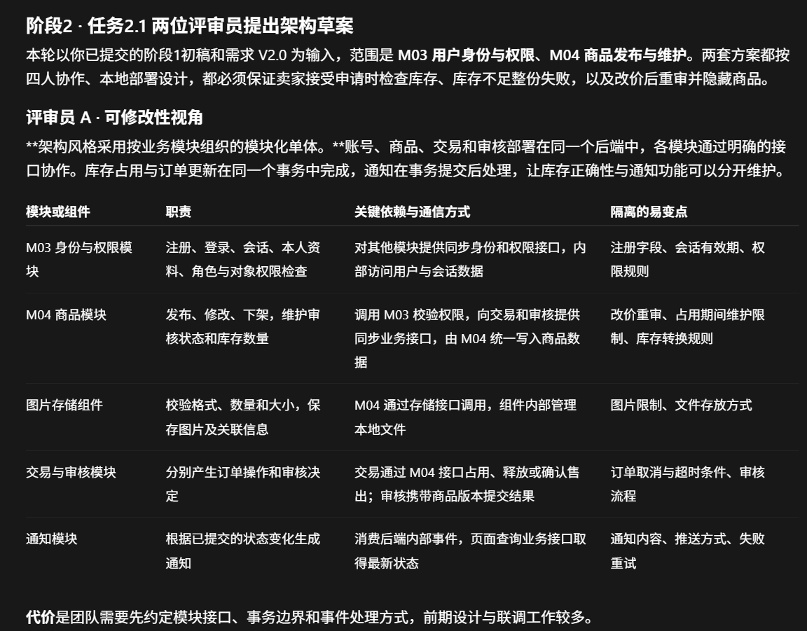
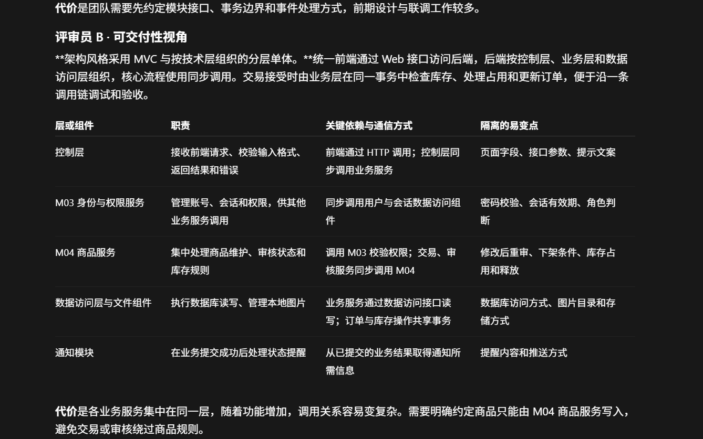
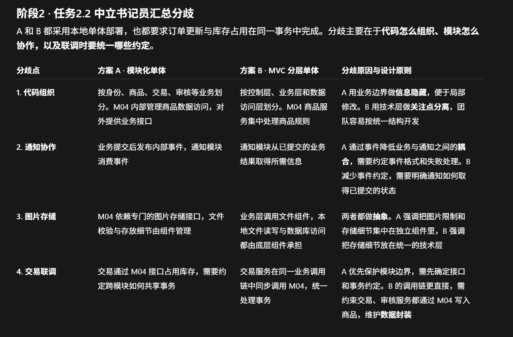
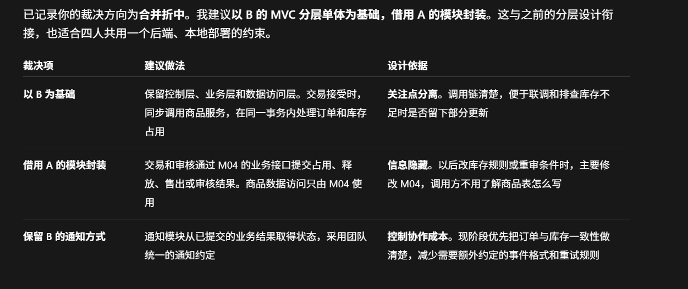

# 架构设计附件1 人机对话截图与提示词

项目：校园二手商品交易系统  
负责人：鲁瑞祺  
日期：2026年11月7日  
对应材料：架构设计阶段2方案评审与裁决

## 一 评审上下文

评审以个人架构设计V1.0和需求规格说明书V2.0为输入，覆盖M03用户身份与权限、M04商品发布与维护。项目由四人协作，在本地部署。比较重点包括商品数据写入边界、库存和订单一致性、重新审核以及联调成本。

## 二 实际提示词与裁决发言

学生在评审前提供了阶段2任务要求，指定由评审员A和B提出两套架构方案，中立书记员比较分歧，最后由学生裁决。以下为实际推进评审时发出的消息。

| 环节 | 学生消息原文 | 对应产出 |
| --- | --- | --- |
| 2.1 启动评审 | 开始阶段二 | 评审员A提出模块化单体，评审员B提出MVC分层单体 |
| 2.2 比较分歧 | 下一步 | 书记员汇总四条分歧及原因 |
| 2.3 选择方向 | 合并这种 | 选择折中，AI提出以B为基础、借用A的商品模块封装 |
| 2.3 确认裁决 | 认可，以后好改 | 学生确认折中方案，主要考虑商品规则以后便于修改 |

## 三 主要对话截图

### 图A1-01 评审员A方案

截图展示任务2.1的项目约束及评审员A的模块化单体方案，包含架构风格、组件职责、依赖、易变点和协调成本。

### 图A1-02 评审员B方案

截图展示评审员B的MVC分层单体方案，包含控制层、业务服务、数据访问及文件组件和通知模块。

### 图A1-03 中立书记员分歧表

截图展示任务2.2在代码组织、通知协作、图片存储和交易联调方面的四项分歧及设计依据。

### 图A1-04 AI提出折中方案

截图展示AI在学生选择折中后提出的基底方案、借用结构和理由。学生随后回复“认可，以后好改”。确认原话见第二节发言原文表。

## 四 对应的阶段2成果

A/B草案、书记员分歧表和正式裁决表见《鲁瑞祺架构设计阶段2_方案评审与裁决_提交版.md》。本附件提供实际消息及截图，完整评审对话保存在原聊天中。
