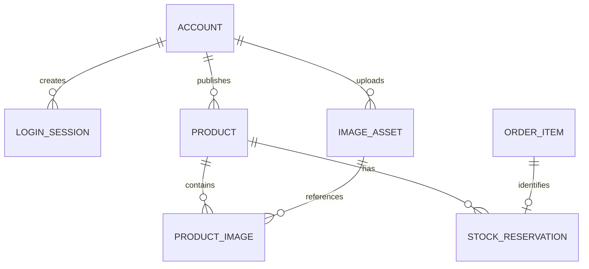
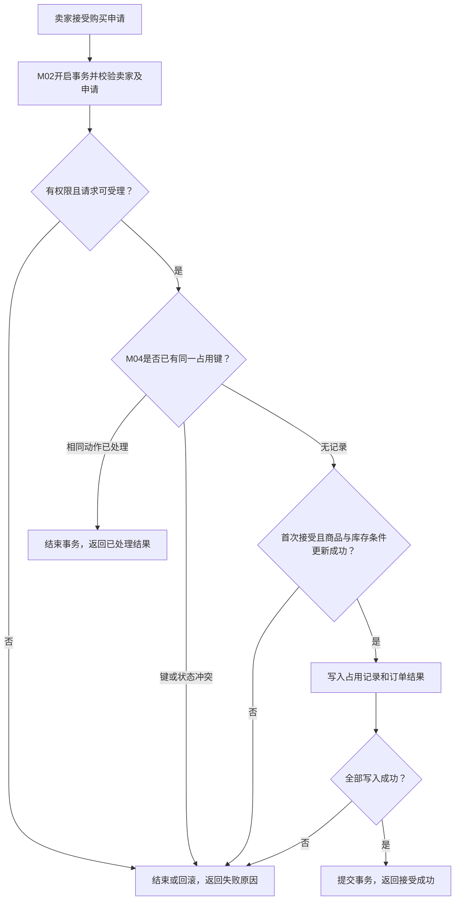

# 架构设计附件2 数据与核心流程设计

项目：校园二手商品交易系统  
负责人：鲁瑞祺  
日期：2026年11月7日  
范围：M03 用户身份与权限、M04 商品发布与维护  
依据：需求规格说明书V2.0、架构设计阶段3裁决D-01～D-04

本附件给出逻辑数据结构和核心操作的过程设计。字段名用于说明结构，物理表名、具体数据库类型与接口名称随团队选型确定。订单商品项、取消及超时条件沿用交易模块的约定。总体架构图见阶段3正文。

## 一 逻辑数据设计

### 1.1 实体及约束

| 数据对象 | 主要字段 | 关键约束 | 负责模块 |
| --- | --- | --- | --- |
| 用户 `Account` | 用户编号、登录名、比较用登录名、密码散列、角色、昵称 | 用户编号为主键。比较用登录名按大小写归一后唯一。普通注册创建普通角色，密码以带盐单向散列保存 | M03 |
| 会话 `LoginSession` | 会话标识、用户编号、创建时间、到期时间、失效状态 | 会话标识唯一并关联用户。到期时间为登录成功时间加2小时。退出使当前会话失效，普通访问不延长到期时间 | M03 |
| 商品 `Product` | 商品编号、卖家编号、名称、描述、单价、审核状态、上下架状态、版本、发布总量、有效占用数量、已售数量 | 商品编号为主键。卖家编号关联用户。单价大于零且最多两位小数，数量为整数。发布总量为正，累计占用与已售数量不得超过总量。库存和商品规则由M04维护 | M04 |
| 图片 `ImageAsset` | 图片编号、上传者、实际类型、字节数、本地存储引用 | 图片编号为主键。JPEG或PNG，单文件不超过5 MiB。存储引用由服务端生成，引用前检查归属 | M04文件组件 |
| 商品图片关联 `ProductImage` | 商品编号、图片编号、展示顺序 | 关联商品和已校验的图片，同一商品不重复关联同一图片。发布及修改时检查有效关联数为1～5张 | M04 |
| 库存占用 `StockReservation` | 订单商品项标识、商品编号、数量、处理状态、创建时间、更新时间 | 订单商品项标识唯一，重试沿用同一标识。数量为正整数，状态为占用中、已释放或已售出。终态记录保留，便于查重和追查 | M04，D-04【Revised】 |
| 订单商品项 `OrderItem` | 稳定业务标识、关联商品、购买数量、成交单价和金额 | 由M02维护。成交信息保存后不随商品内容或价格变化。该标识在库存占用前确定，具体字段及关联由双方确认 | M02接口依赖 |

金额可用整数分表示，例如20.50元记为2050分，输入超过两位小数时拒绝。库存占用记录关联订单商品项，最终是否建立跨表外键由团队统一数据库设计确认。

### 1.2 逻辑关系图

**图A2-01 个人模块逻辑数据关系。**申请尚未被接受时，可以没有对应占用记录。商品图片关联数在发布和修改时由M04校验为1～5张。

### 1.3 一致性规则

- 可购买数量＝发布总量－有效占用数量－已售数量。各数量不得为负，发布后不提供卖家手动调整或补货。
- 订单成交单价、数量与金额使用订单保存的值。商品改价重审时，已保存的成交信息保持原值。
- M04统一处理商品版本、审核状态与库存变化。审核提交所针对的商品版本，卖家修改时校验归属、版本和库存状态。
- 图片先检查类型、大小和归属，商品记录与有效图片关联一起保存。操作失败时不会发布带有无效图片引用的商品。
- 本地持久化范围覆盖账号、商品、审核状态、库存、占用记录及图片引用，正常重启后可以重新读取。

## 二 核心流程一 注册登录与对象权限检查

对应需求L01～L05及验收TC-01～TC-06。入口是注册、登录、本人资料或需要权限的业务请求。

| 步骤 | 处理过程 | 异常及结果 |
| --- | --- | --- |
| 1 注册输入校验 | 验证登录名4～20位，只含英文字母、数字和下划线。检查密码8～64个字符且与确认密码一致 | 不合法时返回对应字段原因，结束注册 |
| 2 创建账号 | 生成比较用登录名及带盐密码散列，按登录名唯一约束保存普通账号 | 同名并发写入时仅一个请求成功。密码及确认密码不进入响应和业务日志 |
| 3 登录建会话 | 按比较用登录名读取账号，校验密码。通过后创建固定2小时有效的会话 | 凭证错误时拒绝，不能获得有效会话 |
| 4 校验访问 | 读取当前会话，检查未退出且当前时间早于到期时间。用会话用户号和角色校验操作及目标归属 | 会话无效提示重新登录。角色或归属不符时拒绝，业务数据不变 |
| 5 修改资料 | 校验请求只修改本人昵称，长度为1～20个字符，写入并返回更新结果 | 非法昵称或修改登录名、角色、余额等字段时拒绝 |
| 6 退出 | 将当前会话标记为失效。再次访问受限功能时，按步骤4拒绝 | 原会话立即失效，通知模块按共同约定停止受限推送访问 |

验收重点为大小写同名、并发注册、会话到期边界和越权。用两个账号检查实际数据结果，验证不能通过修改请求中的用户号取得他人权限。

## 三 核心流程二 卖家接受申请与库存占用

对应需求L07～L09及验收TC-09、TC-13～TC-19、TC-21。触发操作为卖家接受已有购买申请，M02校验订单动作，M04执行商品及库存规则。

### 3.1 接受申请的处理过程

1. M02在事务内检查操作者是否为有权处理的卖家，确认这是可以首次接受的申请或同一接受动作的重试，提供稳定的订单商品项标识、商品编号及购买数量。
2. M04核对同一标识的占用记录。同一动作已完成时按原结果处理。标识相同但商品或数量不同，或操作与已有终态冲突时返回冲突。
3. 无占用记录时，只有首次接受的申请可以继续。M04用商品当前状态和可购买数量作条件更新，要求审核通过、未下架、可购买数量不少于申请数量。更新成功时增加对应有效占用。条件不满足时接受失败，整份申请不产生部分占用。
4. M04保存唯一的「占用中」记录，M02按交易流程保存订单和成交信息。商品数量、占用记录和订单在同一事务中提交。任一写入失败时整体回滚。若并发撞到唯一键，先回滚，再核对已提交记录以识别重试。
5. 业务提交后，页面可重新查询最新订单和商品数量，通知按团队约定获取已提交状态。

**图A2-02 接受申请并占用库存。**查重保护同一订单商品项，条件更新处理不同订单竞争同一商品。唯一键冲突回滚后按步骤4核对。

### 3.2 释放和售出分支

| 动作 | 占用状态条件 | 原子处理结果 |
| --- | --- | --- |
| 合法取消或失效 | 占用中 | 转为已释放，有效占用减少，可购买数量增加同等数量 |
| 完成出售 | 占用中 | 转为已售出，有效占用减少，已售数量等量增加，可购买数量保持原值 |
| 重复同一动作 | 已经达到该动作的结果 | 保持结果和数量 |
| 终态冲突 | 例如已售出后请求释放 | 返回冲突，保持记录和数量 |

只有成功执行对应状态转换的请求才能调整数量，状态转换和订单更新共享事务。合法取消与超时由M02判断，退货和退款沿用交易、售后流程。

### 3.3 典型校验场景

| 场景 | 预期结果 |
| --- | --- |
| 初始3件，两份各2件的申请并发接受 | 恰好一份成功，另一份库存不足。最终有效占用2、可购买1 |
| 成功占用2件，合法取消请求重复到达 | 对应记录只转为已释放一次，初始3件的可购买数量最终为3 |
| 成功占用2件后完成出售 | 有效占用0、已售2、可购买1，售出步骤不重复扣减 |
| 库存只剩1件，接受数量为2 | 整份失败，不自动调整数量，不留下部分订单或占用更新 |
| 商品改价时存在有效占用 | 拒绝修改，商品、订单和库存保持一致 |

## 四 与阶段3及验收的关系

库存占用记录落实阶段3新增设计D-04。M04接口封装对应D-02，事务和层次职责对应D-01。本附件中的表结构及流程为软件设计成果，表中的验收结果为预期，后续联调以真实执行记录为准。
